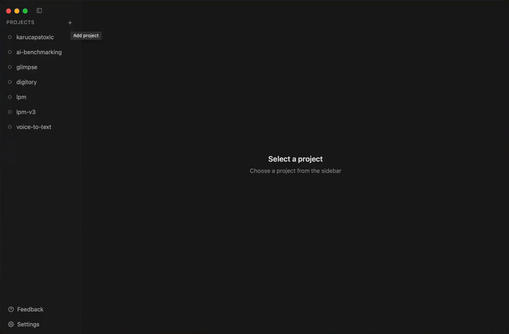
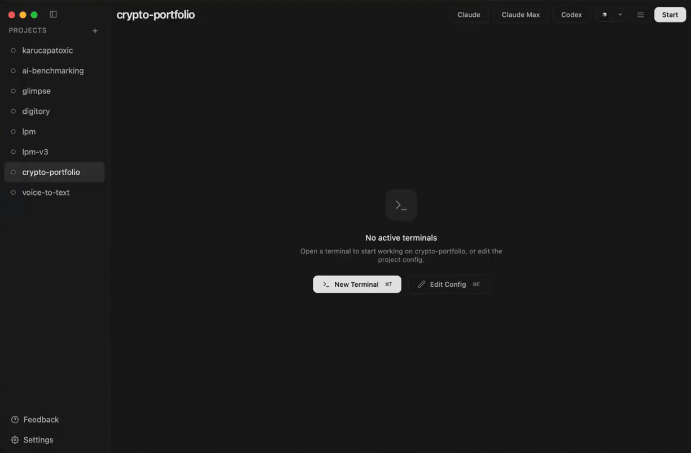
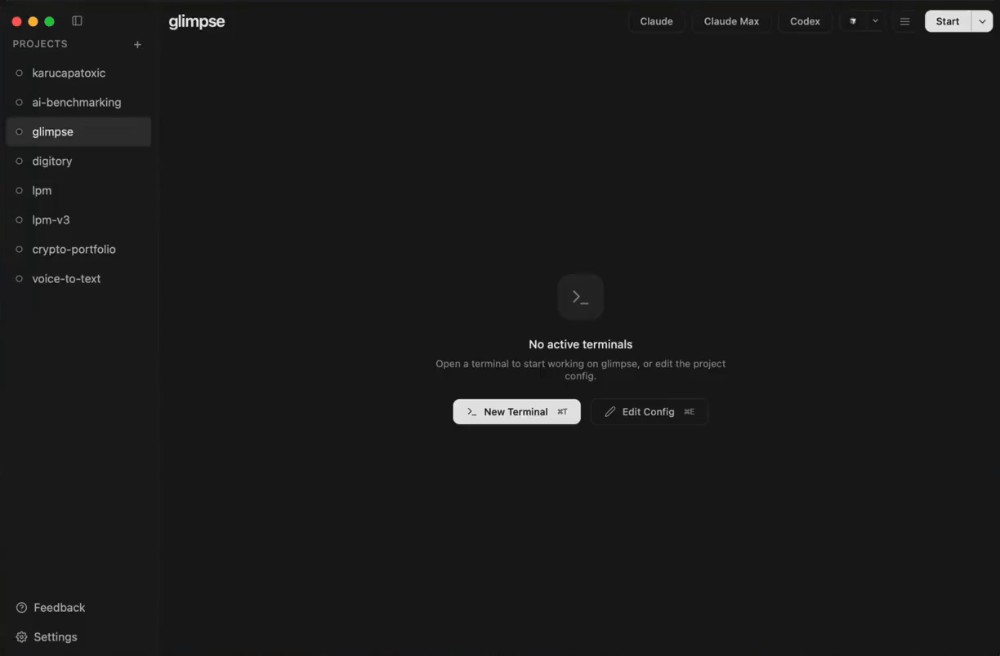
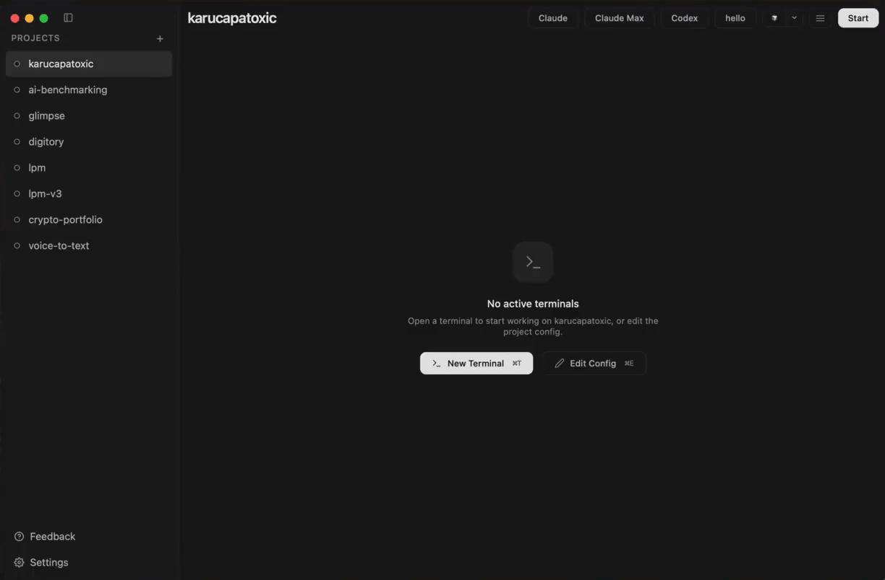
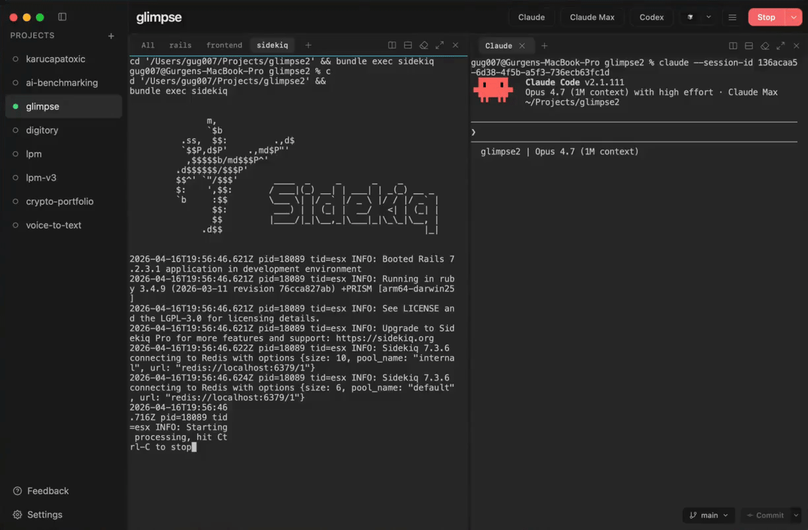
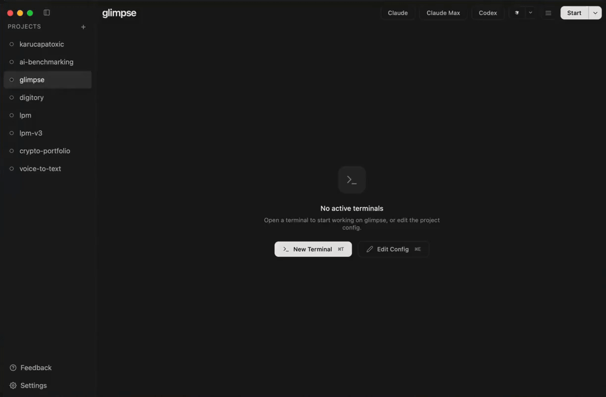

# lpm — Switch between projects and terminals in seconds

<p align="center">
  <i>Start, stop, and duplicate your dev projects in one click.
  Run Claude Code, Codex, and other AI agents side by side on the same codebase.</i>
</p>

<p align="center">
  <a href="https://lpm.cx"></a>
  <a href="https://github.com/gug007/lpm/releases/latest"></a>
</p>

---

<p align="center">
  <a href="https://lpm.cx"><strong>Download lpm</strong></a> for macOS, Windows, and Linux
</p>

lpm is a free desktop app that runs your dev servers and AI coding agents in one window, so you stop juggling terminals.

- Start every service in a project with one click
- Run Claude Code, Codex, and other agents in the built-in terminal
- Give each agent its own copy of the project, so agents don't get in each other's way
- See which agent needs you
- Switch projects without stopping what's running
- Check on your agents from your iPhone with lpm Link

## Install

Download lpm from [lpm.cx](https://lpm.cx):

- **macOS** (Apple Silicon and Intel): open the `.dmg` and drag lpm to Applications
- **Windows 11** (x64, beta): run the installer. Needs [Git for Windows](https://gitforwindows.org)
- **Linux** (x86-64, beta): `.deb`, `.rpm`, or AppImage. Needs Ubuntu 22.04 or newer, or another distro with glibc 2.35+

On your iPhone, get [lpm Link](https://apps.apple.com/us/app/lpm-link/id6788396977) from the App Store.

## See it in action

<p align="center">
  <strong>Add a project</strong> — pick a folder or clone a repo, and lpm finds its services<br><br>
  
  <br><br>
  <strong>Start a project</strong> — one click, live terminal output for every service<br><br>
  
  <br><br>
  <strong>Run AI agents alongside your services</strong> — Claude Code, Codex, or any agent in the same workspace<br><br>
  
  <br><br>
  <strong>Duplicate a project</strong> — run an agent in each copy, in parallel, no conflicts<br><br>
  
  <br><br>
  <strong>Fast switching</strong> — start, stop, and jump between projects in seconds<br><br>
  
  <br><br>
  <strong>Split terminals</strong> — arrange services and agents side-by-side<br><br>
  
  <br><br>
  <strong>Control it from your iPhone</strong> — pair <a href="https://apps.apple.com/us/app/lpm-link/id6788396977">lpm Link</a>, then start services and talk to agents on your Mac<br><br>
  
</p>

## Why lpm?

- **Finds your services for you**: Node, Python, Ruby, Go, Rust, PHP, Java, .NET, Docker Compose, and more
- **No Docker required**: your services run natively
- **Actions**: one-click buttons for tests, migrations, and deploys
- **Profiles**: start only the services you need
- **Works with any stack**: if it runs in a terminal, lpm can run it

## AI agent skills

Let your AI agent set up and control lpm for you:

```bash
npx skills add gug007/lpm
```

Then tell your agent "set up lpm for this project".

- [`lpm-config`](lpm-config) writes and edits project config
- [`lpm-cli`](lpm-cli) starts and stops projects, reads logs, and makes copies (uses the `lpm` command, which you install from the app's Settings)
- [`lpm-memory`](lpm-memory) saves work notes, so another agent can pick up where the last one left off

## Feedback and contributing

- Bugs: [open an issue](https://github.com/gug007/lpm/issues/new)
- Ideas and questions: [start a discussion](https://github.com/gug007/lpm/discussions)
- Code: see [CONTRIBUTING.md](CONTRIBUTING.md)

In the app, **lpm menu → Help Improve lpm…** does this for you.

## License

[MIT](LICENSE)
